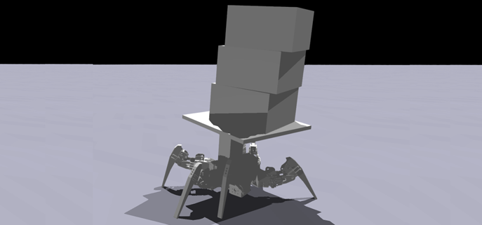
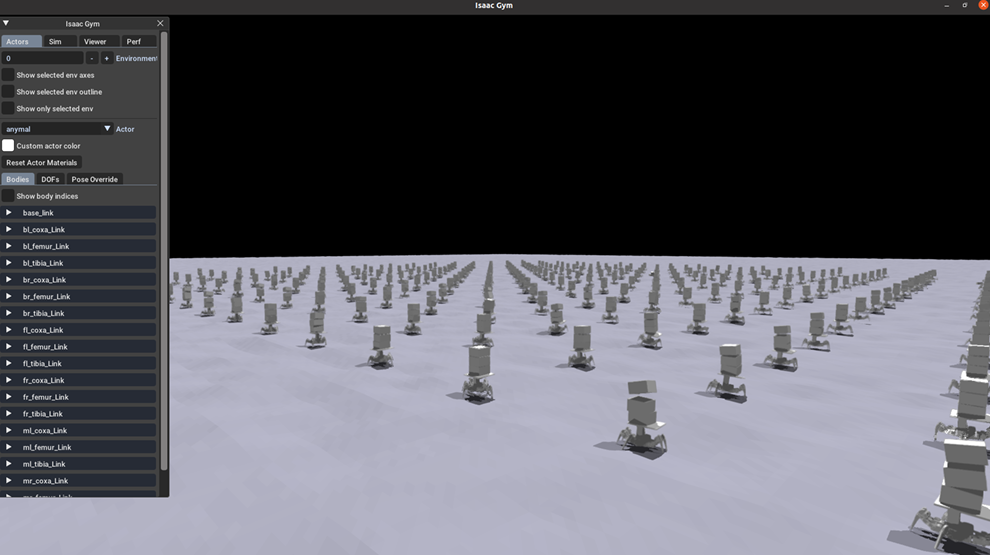

# Deep Reinforcement Learning for Hexapod Robot Control

## Overview

An academic codebase for hexapod locomotion and object transportation using
**NVIDIA Isaac Gym** and **Proximal Policy Optimization (PPO)**. The research
investigates how a hexapod robot can carry objects across terrain while
following locomotion commands. This repository provides the preserved
simulation task, robot assets, and associated training implementation.

The research is presented in **A Deep Reinforcement Learning Algorithm for
Objects Balance Control with Hexapod Robot**, by Yu-Hao Tsai, Saeed Saeedvand,
and Jacky Baltes, published at **ICCRE 2025**.

**[Paper (IEEE Xplore)](https://ieeexplore.ieee.org/document/11093566)** ·
**[Original demonstration video](https://drive.google.com/file/d/1CU9ajgWKnAI1ainfM-g37qSE5lLipkwa/view?usp=sharing)** ·
**[Getting started](docs/getting-started.md)**

<p align="center">
  
  <br>
  <em>Hexapod robot carrying stacked objects in simulation.</em>
</p>

The screenshots and linked video illustrate the original research; they are
not evidence of a newly verified run of the current application.

## Simulation Environment

NVIDIA Isaac Gym enables GPU-based parallel simulation for reinforcement
learning. PPO trains the locomotion policy through interaction with the
hexapod task, which includes terrain and carried objects. Simulation uses
Isaac Gym Preview 4 and an external IsaacGymEnvs checkout; the learning
components use PyTorch.

<p align="center">
  
  <br>
  <em>Parallel hexapod training environments in NVIDIA Isaac Gym.</em>
</p>

## Installation

**Follow the [installation and training guide](docs/getting-started.md)** for
the full prerequisites, compatibility notes, and troubleshooting. The workflow
below summarizes its installation procedure for a new Linux workspace.

1. **Prepare Isaac Gym Preview 4 and its Python environment.** Follow the SDK's
   bundled instructions and the guide's [runtime prerequisites](docs/getting-started.md#1-prerequisites-and-the-provisional-runtime).
   The provisional target is Ubuntu 20.04, Python 3.8, and PyTorch 1.13.1 with
   CUDA 11.7. Native execution of the current application with this combination
   remains unverified.

2. **Prepare the compatible external IsaacGymEnvs checkout.** Use revision
   `aeed298638a1f7b5421b38f5f3cc2d1079b6d9c3`. After satisfying the guide's
   runtime and Python 3.8-compatible build prerequisites:

   ```bash
   mkdir -p "$HOME/hexapod-work"
   cd "$HOME/hexapod-work"
   git clone https://github.com/isaac-sim/IsaacGymEnvs.git
   git -C IsaacGymEnvs checkout aeed298638a1f7b5421b38f5f3cc2d1079b6d9c3
   python -m pip install --no-deps --no-build-isolation --editable "$HOME/hexapod-work/IsaacGymEnvs"
   ```

3. **Clone this repository.** Run the remaining commands from its root:

   ```bash
   cd "$HOME/hexapod-work"
   git clone https://github.com/Leo813/hexapod_proj.git
   cd hexapod_proj
   ```

4. **Install the hexapod task and assets.** Preview, apply, and verify the files:

   ```bash
   python -B scripts/install_hexapod_task.py --isaacgymenvs "$HOME/hexapod-work/IsaacGymEnvs"
   python -B scripts/install_hexapod_task.py --isaacgymenvs "$HOME/hexapod-work/IsaacGymEnvs" --apply
   python -B scripts/install_hexapod_task.py --isaacgymenvs "$HOME/hexapod-work/IsaacGymEnvs" --verify
   ```

   The installer preserves identical files and blocks conflicting files. Keep
   the external root configuration and complete asset tree. A manual-copy
   alternative is documented in the [guide](docs/getting-started.md#5-install-the-original-task-and-assets).

5. **Install the Python package in the same environment.**

   ```bash
   python -m pip install --no-deps --no-build-isolation --editable "$HOME/hexapod-work/hexapod_proj"
   ```

   These pip flags preserve the prepared dependency stack; they do not install
   missing prerequisites. Complete the guide's [package discovery checks](docs/getting-started.md#6-install-the-custom-ppo-package-and-verify-discovery)
   before starting training below.

## Training

After installation and native compatibility checks on your machine, run:

```bash
python train_agent.py
```

The launcher selects the `hexapod` task and `hexapodPPO` configuration. Defaults
use GPU simulation and learning, 256 parallel environments, a viewer, and a
maximum of 600 training epochs.

```bash
# Run without a viewer
python train_agent.py headless=True

# Use fewer parallel environments
python train_agent.py num_envs=64 max_iterations=100

# Select the external checkout if automatic discovery is unavailable
python train_agent.py isaacgymenvs_path=/absolute/path/to/IsaacGymEnvs
```

`headless=True` disables the viewer while retaining GPU execution. `num_envs`
sets the number of parallel environments, and `max_iterations` sets the total
training epoch limit. The smaller example also triggers the existing minibatch
adjustment. Use `python train_agent.py --help` for supported options.

Outputs default to `runs/Anymal_<timestamp>/`. See the guide for
[training options](docs/getting-started.md#7-start-training) and
[checkpoint saving and resuming](docs/getting-started.md#8-outputs-and-resuming-training).

## Evaluation

Load a checkpoint produced by this training application:

```bash
python train_agent.py test=True checkpoint=/path/to/last.pt

# Evaluate without a viewer
python train_agent.py test=True checkpoint=/path/to/last.pt headless=True
```

Evaluation uses deterministic policy means and frozen normalization, without
PPO updates. Set `eval_steps=1000` to specify the evaluation duration in steps
(1000 is the default). See the [evaluation guide](docs/getting-started.md#9-evaluate-a-trained-agent)
for configuration compatibility and checkpoint loading requirements.

## Repository Structure

| Path | Purpose |
| --- | --- |
| `train_agent.py` | Training and evaluation entry point |
| `src/hexapod_rl/` | PyTorch PPO, policy networks, and environment integration |
| `hexapod.py` | Isaac Gym hexapod task |
| `hexapod.yaml`, `hexapodPPO.yaml` | Task and feedforward PPO configuration |
| `hexapod2/` | Robot URDFs, meshes, and package metadata |
| `images/` | Original simulation screenshots |
| `scripts/` | Task installation and native readiness utilities |
| `tests/`, `ci/` | Offline automated tests and strict test runner |
| `docs/` | Installation, executable baseline, and implementation documentation |

Technical details are available in the [baseline contract](docs/baseline-contract.md),
[PPO implementation notes](docs/ppo-implementation.md), and
[reference mapping](docs/reference-implementation.md).

## Testing Status

The [CPU CI workflow](.github/workflows/pytorch-tests.yml) runs on Ubuntu 22.04
with Python 3.10 and PyTorch 1.13.1+cpu. Its strict runner requires at least
209 tests with no failures, errors, or skips. Tests cover learning components,
configuration, checkpoint handling, integration fixtures, and installation
utilities without Isaac Gym. Consult the [Actions results](https://github.com/Leo813/hexapod_proj/actions)
for the revision you use.

In a prepared CPU test environment:

```bash
python -B -m unittest discover -s ci -p 'test_*.py' -v
python -B ci/run_stage1_tests.py
```

Local runs with missing dependencies may skip tests. CPU tests and mocks do
not establish native GPU compatibility, simulator behavior, successful
training, or reproduction of the paper's results.

## License

The independently developed software is provided under the [MIT License](LICENSE),
to the extent the repository owner holds the necessary rights. Third-party
code, robot assets, and research materials retain their applicable terms;
see [Third-party notices](THIRD_PARTY_NOTICES.md). The root license does not
grant rights over robot assets whose licensing remains uncertain.

## Citation

If you find this project useful in your research, please consider citing our paper:

Y.-H. Tsai, S. Saeedvand, and J. Baltes,
"[A Deep Reinforcement Learning Algorithm for Objects Balance Control with Hexapod Robot](https://ieeexplore.ieee.org/document/11093566),"
in *2025 10th International Conference on Control and Robotics Engineering (ICCRE)*,
2025, pp. 34–39, doi: [10.1109/ICCRE65455.2025.11093566](https://doi.org/10.1109/ICCRE65455.2025.11093566).

```bibtex
@INPROCEEDINGS{11093566,
  author={Tsai, Yu-Hao and Saeedvand, Saeed and Baltes, Jacky},
  booktitle={2025 10th International Conference on Control and Robotics Engineering (ICCRE)},
  title={A Deep Reinforcement Learning Algorithm for Objects Balance Control with Hexapod Robot},
  year={2025},
  pages={34-39},
  doi={10.1109/ICCRE65455.2025.11093566}
}
```
